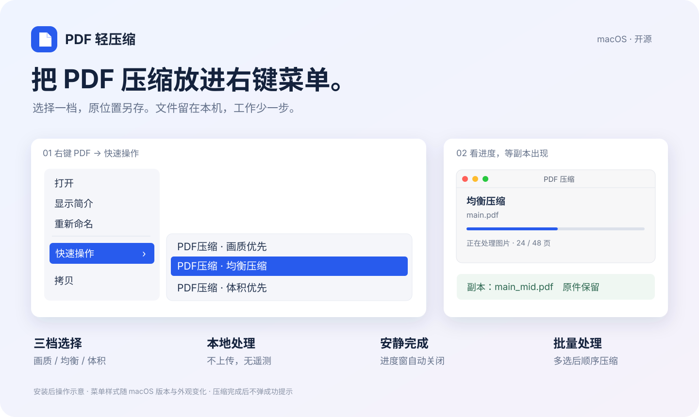

<div align="center">

# PDF 轻压缩

**把 PDF 压缩放进右键菜单。**

给 macOS 的本地 PDF 压缩小工具。选一档，原位置另存，继续做你的事。

[](https://github.com/Fucheng1245/pdf-compressor/actions/workflows/tests.yml)
[](LICENSE)
[](#macos-安装)

[开始安装](#macos-安装) · [看实测效果](#一份-48-页-pdf-的实测效果) · [贡献代码](CONTRIBUTING.md)



</div>

## 安装之后，用起来就是这样

1. 在 Finder 中选中一个或多个 PDF，右键打开 **快速操作**。
2. 点击 **画质优先 / 均衡压缩 / 体积优先**，立即开始。
3. 进度窗自动关闭，副本直接出现在原文件夹，原件保留。

上图为安装后操作示意，展示实际入口名称、进度窗信息和输出命名；系统外观随 macOS 版本及设置变化。

## 为什么用它

| 你关心的事 | 它的做法 |
| --- | --- |
| 少一步操作 | 直接在文件的右键菜单中压缩，无需打开应用或拖入文件 |
| 文件隐私 | 压缩在本机完成，不上传、无遥测，无需账户 |
| 阅读体验 | 保留可提取文字与矢量图，较大图片按档位压缩 |
| 保留原件 | 同目录生成副本，重名自动编号；变大则保存原件的等大小副本 |
| 不打断工作 | 处理时显示进度，完成后自动关闭，无成功弹窗、无后台常驻 |
| 多份文件 | 支持多选与顺序处理；同时发起的任务自动排队 |

## 一份 48 页 PDF 的实测效果

原文件 **87.1 MiB**。同一份 PDF，本机测试结果如下：

| 档位 | 压缩后 | 体积降低约 | 核心处理耗时约 |
| --- | ---: | ---: | ---: |
| 画质优先 | 59.2 MiB | 32% | 2 秒 |
| 均衡压缩 | 10.9 MiB | 88% | 8 秒 |
| 体积优先 | 7.6 MiB | 91% | 7 秒 |

这是一个样本，结果取决于图片、编辑数据和文件结构；耗时不含 Finder 启动与排队。三档文字提取与原件逐字一致；画质优先在该样本的渲染检查中与原件一致。均衡与体积优先对图片有损压缩。详细方法见 [验证记录](docs/VERIFICATION.md) 和 [性能对照](docs/OPTIMIZATION.md)。MiB 按 1024² 字节计算。

## 选哪一档

日常分享先选 **均衡压缩**；对图像细节敏感时选 **画质优先**；文件体积受限时试 **体积优先**。

| 快速操作 | 输出示例 | 策略 |
| --- | --- | --- |
| PDF压缩 · 画质优先 | `main_high.pdf` | 不重新编码图片；清理编辑数据、去重并无损压缩内部数据流 |
| PDF压缩 · 均衡压缩 | `main_mid.pdf` | 同上，并将较大图片限制到最长边 2400 像素、JPEG 质量参数 85 |
| PDF压缩 · 体积优先 | `main_low.pdf` | 同上，并将较大图片限制到最长边 1600 像素、JPEG 质量参数 72 |

high / mid / low 表示保留的画质，不表示压缩力度。JPEG 参数不是画质百分比。小图、特殊遮罩或无法安全解码的图片保持原样；文字和矢量图不整页栅格化。不同 PDF 的压缩收益不同，不承诺固定大小或三档结果必然严格排序。

## macOS 安装

需要 macOS 13+ 和 Apple Command Line Tools（用于安装时编译原生进度窗，运行时无需编译器）；本地实际验证环境为 macOS 14.6。先安装 [uv](https://docs.astral.sh/uv/getting-started/installation/)；如果尚未安装 Apple Command Line Tools，执行 `xcode-select --install`。从 GitHub 克隆仓库后执行：

```bash
git clone https://github.com/Fucheng1245/pdf-compressor.git
cd pdf-compressor
uv run --python 3.12 --no-project python scripts/install.py
```

安装器为当前用户建立独立 Python 3.12 环境并安装固定版本依赖；第一次安装需要联网下载运行环境和依赖。压缩时不联网，不依赖 Codex、Homebrew Python 或仓库源文件位置，也不需要管理员权限。

安装位置：

- `~/Library/Application Support/PDFCompressor/venv/`：隔离运行环境。
- `~/Library/Services/PDF压缩 · <档位>.workflow`：三个右键入口。
- `~/Library/Application Support/PDFCompressor/Progress.app/`：仅处理期间运行的原生进度窗。
- `~/Library/Logs/PDFCompressor/compress.log`：本机轮转日志，包含路径、体积和错误，不记录正文。

在 Finder 中右键 PDF → **快速操作 → PDF压缩 · 画质优先 / 均衡压缩 / 体积优先**。支持多选，逐个处理；多个调用排队，避免同时占满 CPU 和内存。

三个档位平铺在“快速操作”下。没有额外的 PDF 压缩子菜单，也没有后台常驻服务。

安装器会在当前用户的 `pbs` 偏好中启用本工具的三个入口，使用原生布尔值和整数，保留其他服务设置；这套服务标识已在 macOS 14.6 验证，其他系统版本仍需验证。卸载时同步清理本工具的启用项。如果入口尚未出现，在系统设置搜索“扩展”或“服务”，启用对应 Finder 快速操作，再重新打开 Finder 窗口。系统可能请求访问选中文件所在文件夹的权限。失败时尝试发出系统通知；若通知被系统禁止，查看本机日志。处理中进度窗显示档位、文件名和当前阶段；图片阶段按处理页数显示进度，其他阶段使用等待动画，不显示估计百分比或剩余时间。多选时显示当前文件序号，排队时显示等待提示。窗口提供原生红黄绿按钮：红色仅关闭进度窗，压缩继续；黄色最小化，绿色缩放（不全屏）。结束后自动关闭，成功没有通知，文件直接出现在原文件夹中。

卸载：

```bash
uv run --python 3.12 --no-project python scripts/uninstall.py
```

只删除本工具的快速操作、对应菜单偏好和独立运行环境；其他快速操作、PDF 原件、输出和日志保留。更新后重新运行安装命令即可。

## 命令行与开发

Python 3.10+，跨平台压缩核心；Finder 集成仅适用于 macOS。

```bash
uv venv --python 3.12
uv pip install --python .venv/bin/python '.[test]'
.venv/bin/pdfcompress --preset low -- '/path/to/main.pdf'
.venv/bin/python -m pytest
```

命令行输出 JSON：原路径、输出路径、档位、处理前后字节数、页数、图片处理数量；批次中有失败返回非零状态，其他文件继续处理。Finder 调用采用 `--finder` 模式，显示进度，成功记录本机日志。进度窗异常或缺失不影响压缩；命令行默认不弹窗。

Python 接口：

```python
from pdfcompressor.core import compress
result = compress('/path/to/main.pdf', preset='high')
print(result.output, result.before_bytes, result.after_bytes)
```

API 可传入 `progress(stage, completed, total)` 回调；仅 `images` 阶段的页数进度可计量，其他阶段的 total 为 0。原有调用兼容。

源码位于 `src/pdfcompressor/`；安装/卸载及工作流生成位于 `scripts/`；`tests/` 使用自动生成的非私人测试文件。依赖固定在 `pyproject.toml`，升级依赖时必须运行功能和渲染回归，特别关注 pypdf 内部对象 API。GitHub Actions 在 Linux/macOS 和 Python 3.10/3.12 上运行测试。

## 文件行为与边界

- 原件不改动；重名自动生成 `main_high_2.pdf` 等，避免覆盖文件或符号链接。
- 输出先写入同目录临时文件，重新读取并校验页数，完成后发布；处理失败清理临时文件。
- 如果压缩结果更大，改为保存原文件的等大小副本。没有压缩收益不算失败。
- 保留页面、文本、注释、表单、书签与嵌入附件；清理 `/PieceInfo` 编辑记录和 Illustrator 私有数据，副本不再保留这些编辑能力。
- 暂不处理加密 PDF 和已签署的数字签名 PDF；不移除密码、不使签名失效后假装仍有效。
- PDF 内嵌链接和引用可以保留，但外部编辑工作流依赖隐藏数据时，请继续使用原文件。
- low/mid 图片压缩有损，适合阅读和分享；印刷和重要图像优先用 high 并自行检查。不会预先显示不可靠的 MB 估计。
- 不包含网络请求、遥测、启动项或后台服务。资源只在手动调用时使用；Automator 自身可能显示系统执行状态。

## 验证与性能

当前为 v0.1.0。压缩核心及三个 Finder 右键入口均已在 macOS 14.6 实际点击验证，详见 [验证记录](docs/VERIFICATION.md)。性能优化后，本机这份 48 页 PDF 三档分别约需 2 / 8 / 7 秒；具体取决于文件内容，见 [性能记录](docs/PERFORMANCE.md) 和 [第二轮方案对照](docs/OPTIMIZATION.md)。

## 开源与发布

这是独立仓库，不包含论文或个人 PDF、日志、运行环境和生成的输出。安装器从检出的本地代码构建安装包。当前不提供签名 DMG、自动更新或 Finder 扩展。

许可证：[MIT](LICENSE)。版本记录见 [CHANGELOG](CHANGELOG.md)，参与开发见 [贡献指南](CONTRIBUTING.md)。
